# Mohaseb Pro | محاسب پرو

[](https://github.com/saeed-dev-nex/mohaseb-pro/actions/workflows/ci.yml)
[](VERSION)
[](LICENSE)

[](README.md)
[](README.fa.md)

A Persian financial management and invoicing system for service businesses — focused on fast invoicing, accurate vehicle information, and secure backups. The user interface is fully right-to-left and supports the Jalali (Persian) calendar, Persian digits, and standard invoice printing.

**Current version: 3.5.1** — see the [CHANGELOG](CHANGELOG.md) for release details and the [ROADMAP](ROADMAP.md) for the development plan. This README is also available in [فارسی (Persian)](README.fa.md).

## Screenshots

> Screenshots are taken from the real application; customers' personal information has been blurred.

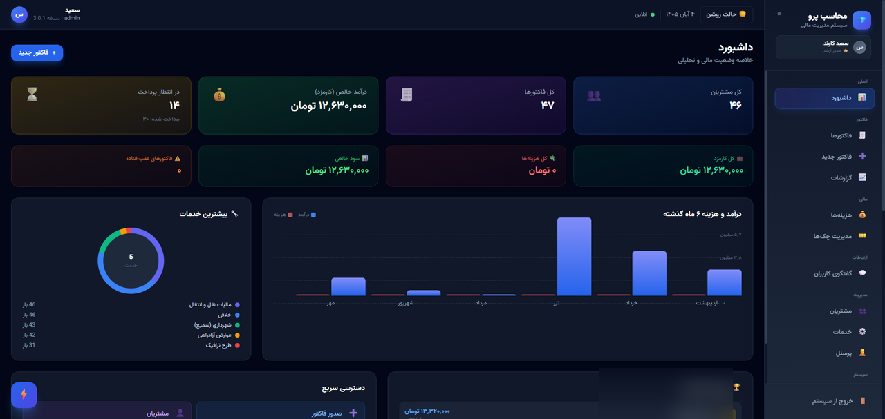

| New invoice | Invoices |
|---|---|
| 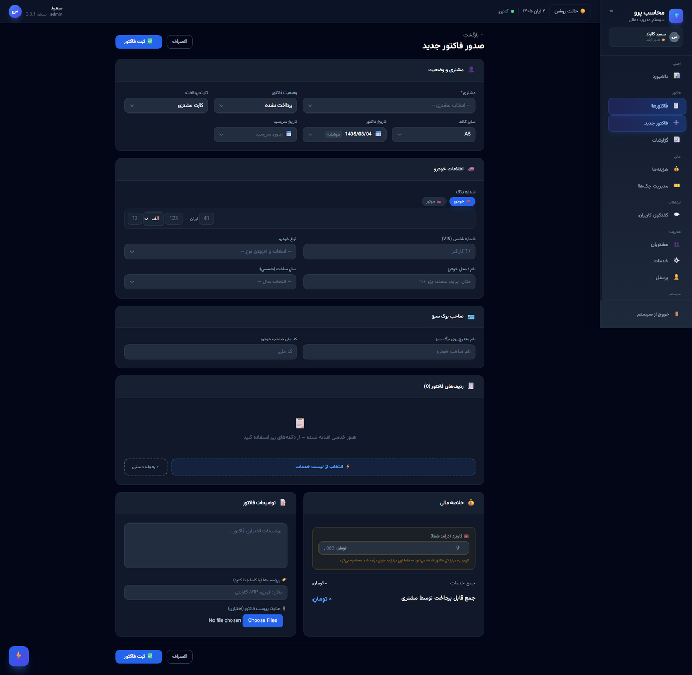 | 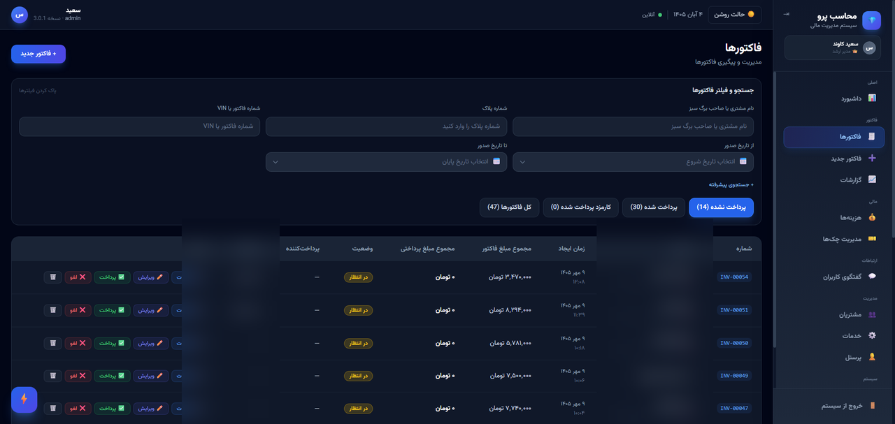 |

| Invoice details | Financial reports |
|---|---|
| 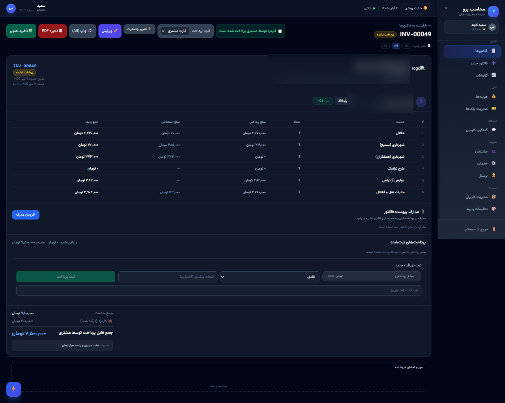 | 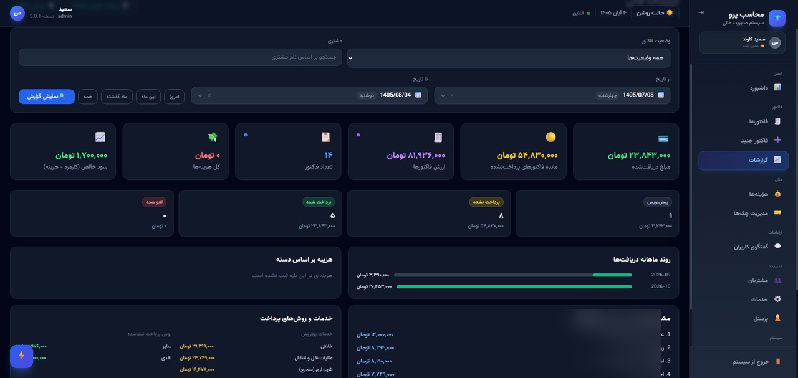 |

| Customers | Services |
|---|---|
| 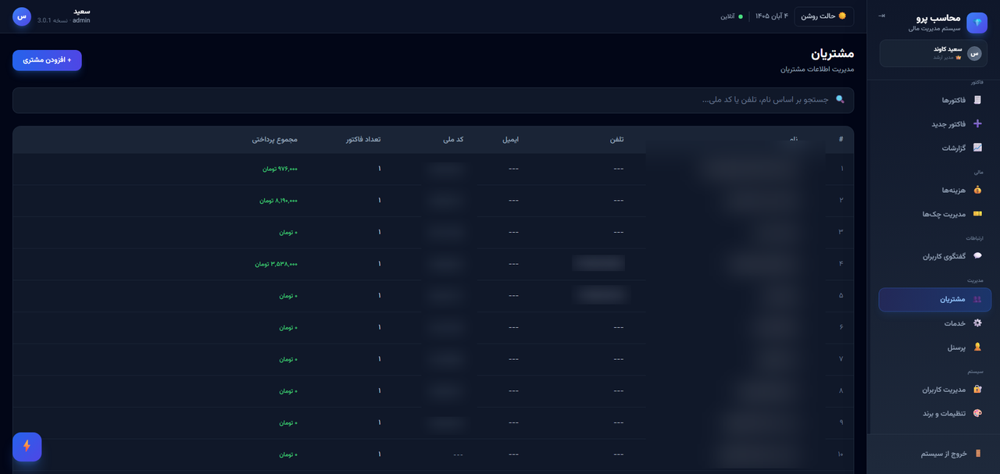 | 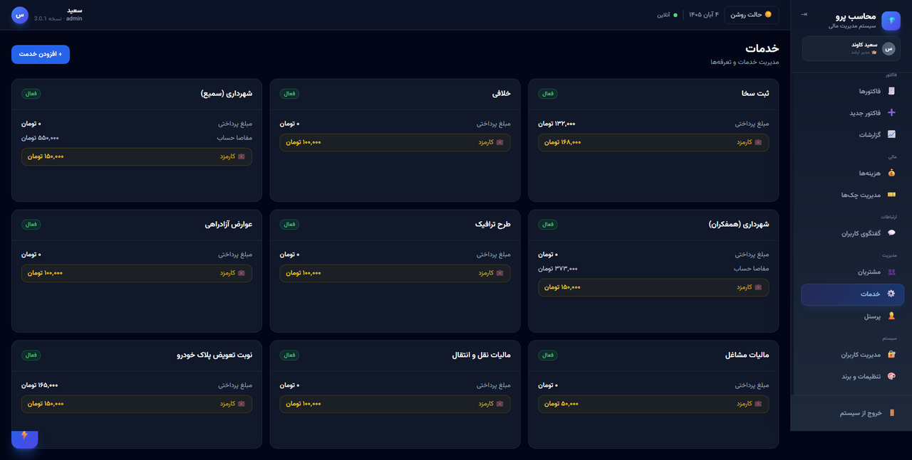 |

| Expenses | Cheque management |
|---|---|
| 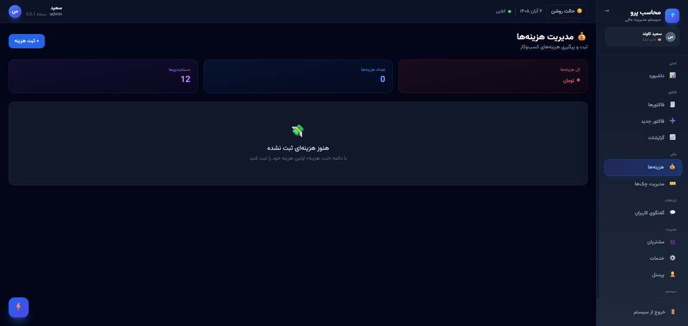 | 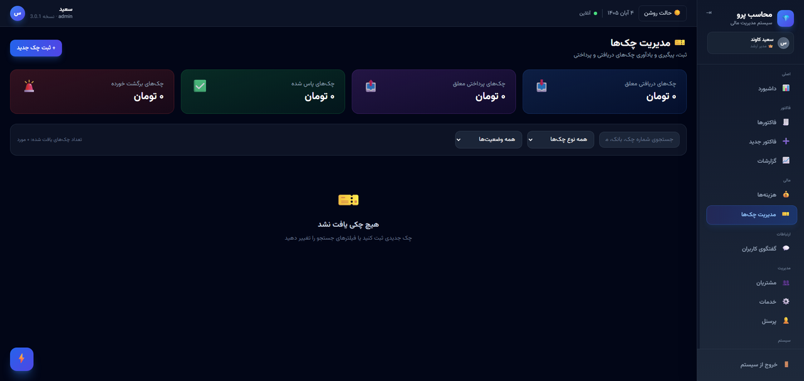 |

| Settings | User chat |
|---|---|
| 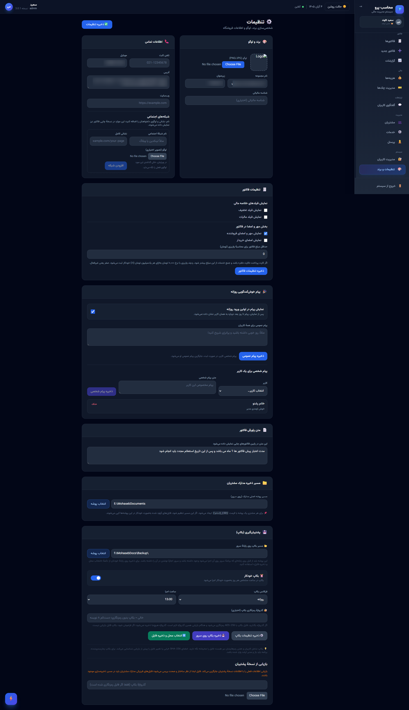 | 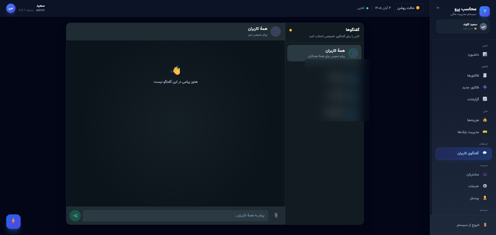 |

## Features

### Invoicing
- **Step-by-step quick invoice** — issue an invoice in four short steps (customer & vehicle → services → commission → status & save), fully keyboard-driven
- **License-plate suggestion** — entering a full plate number suggests the vehicle's latest invoice and loads its details and line items with one click
- **Ready-made service packages** — define packages in Settings and add all their services with one click
- **Clone invoice**, automatic drafts, and remembered operator defaults (status and payment card)
- Full invoice form with a structured vehicle/motorcycle section (plate, VIN, type, model, year), registration document and due date
- **Precise one-page printing** in A4, A5 and A6 sizes, plus PDF/JPG export of the invoice sheet

### Management & reporting
- Customers, services, expenses, cheques, staff and users with **module-level access control**
- Financial reports with Excel and CSV export, and a change history (audit log)
- Live user chat with file attachments and new-message notifications
- Quick-invoice browser extension for Chrome and Firefox

### Backup & security
- Scheduled local backups + **encrypted cloud backup** to S3-compatible storage (e.g. ArvanCloud) with checksum verification and automatic pruning of old versions
- Cloud keys are stored encrypted in the database, never in plain text
- JWT authentication, login-attempt rate limiting, and logging of sensitive events

### User experience
- Dark and light themes with checked contrast (WCAG AA standard)
- Keyboard shortcuts editable from Settings
- Fully Persian, right-to-left interface with Jalali dates and Persian digits, installable as a PWA

## Tech stack

| Part | Technology |
|---|---|
| Backend | Django 5 + Django REST Framework, Daphne (WebSocket), SQLite |
| Frontend | React + TypeScript, Vite, TanStack Query, Tailwind CSS |
| Printing & export | Dedicated CSS Print, Excel export (openpyxl) |
| Cloud backup | S3-compatible (boto3) + AES encryption (Fernet) |

## Prerequisites

- Windows 10 or later for the ready-made scripts
- Python 3.10 or later (on Windows with Python 3.15, the project launcher automatically installs the network dependency without the optional C++ extension)
- Node.js 18 or later and npm

## Getting started on Windows

1. Clone the repository:

   ```powershell
   git clone https://github.com/saeed-dev-nex/mohaseb-pro.git
   cd mohaseb-pro
   ```

2. Run `run.bat` and choose the `dev` mode. The script prepares the Python virtual environment and the backend dependencies; on the first run, also install the frontend dependencies with npm:

   ```powershell
   cd frontend
   npm install
   cd ..
   .\run.bat
   ```

3. Open the app at `http://localhost:5173`. The API is available at `http://localhost:8000/api/`.

On the first backend start, an admin account is created and its initial password is printed to the terminal output only that one time. Keep it safe and change it after signing in.

For a single-port production run use `run_production.bat`; for access from other machines on the local network use `run_network.bat`.

### Install as an app (PWA)

After running the production build with `npm run build` and `npm run preview`, open the app once from `http://localhost:4173` in Chrome or Edge and choose "Install Mohaseb Pro" (or use the install icon in the address bar). The app then launches from the Start menu or a desktop shortcut, without typing an address. PWA installation requires `localhost` or HTTPS; browsers do not install it over plain HTTP on a LAN address.

### Updating on each machine

To safely receive changes from GitHub, run this command in the project root:

```powershell
.\update_project.ps1
```

The script first checks for uncommitted changes and, if any exist, does not overwrite any file. It then merges the current branch's changes from `origin` and updates backend migrations, frontend dependencies and the production build. To fetch code without building, use `./update_project.ps1 -SkipBuild`. This check now also runs before `run.bat` and `run_network.bat`; if GitHub is unreachable or you have uncommitted local changes, the app runs with the local version. Automatic updating only works for a folder obtained with `git clone`; copies downloaded as ZIP or release folders have no Git repository and run the local version with an informational message.

## Running with Docker (all operating systems)

If you have Docker, the full app runs without installing Python or Node:

```bash
cp .env.example .env   # then put a random DJANGO_SECRET_KEY in .env
docker compose up --build
```

The app opens at `http://localhost:8080` and the API is also directly available at `http://localhost:8000/api/`. The initial admin password is printed only on the first run in the backend logs: `docker compose logs backend`. The database and uploaded files persist in the `mohaseb_data` volume and are not lost when containers stop and start.

### Manual run

Backend:

```powershell
cd backend
py -3 -m venv .venv
.\.venv\Scripts\Activate.ps1
$env:AUTOBAHN_USE_NVX = "0" # for Python 3.15 on Windows
python -m pip install -r requirements.txt
python manage.py migrate
python manage.py ensure_admin
python manage.py runserver
```

Frontend, in a separate terminal:

```powershell
cd frontend
npm install
npm run dev
```

## Configuration

Configure Django through environment variables; every variable is exemplified in [`.env.example`](.env.example). For a real deployment, set `DJANGO_SECRET_KEY` to a random, private value, turn `DJANGO_DEBUG` off, and explicitly set the trusted hosts. Note: if `DJANGO_DEBUG` is off and `DJANGO_SECRET_KEY` is not set, the backend deliberately refuses to start, because a per-run random key would invalidate all login tokens on every restart.

| Variable | Development default | Description |
| --- | --- | --- |
| `DJANGO_SECRET_KEY` | Random key on each run | Set a private, stable Django key for real deployments. |
| `DJANGO_DEBUG` | `true` | Set to `false` for production. |
| `DJANGO_ALLOWED_HOSTS` | `localhost,127.0.0.1,[::1]` | Allowed host names, comma-separated. |
| `DJANGO_CORS_ALLOWED_ORIGINS` | Loopback addresses on 5173 and 4173 | Allowed frontend origins, comma-separated. |
| `VITE_API_URL` | Backend address based on the browser's current host | Base API URL for the frontend; append `/api/` as well. |

The SQLite database and uploaded files are stored in the `backend/` folder and are not part of the repository. Back them up separately.

## Browser extensions

- **Chrome:** enable Developer mode on the extensions page and load the `chrome-extension/` folder unpacked.
- **Firefox:** for a temporary test, open `about:debugging` → `This Firefox` → `Load Temporary Add-on` and select `firefox-extension/manifest.json`; a temporary install is removed when Firefox closes. For a permanent install, build the package with `firefox-extension/package.ps1` and, after AMO signing, install the XPI file. A step-by-step illustrated guide (in Persian) is in [`firefox-extension/INSTALL_FIREFOX_FA.md`](firefox-extension/INSTALL_FIREFOX_FA.md).

The extensions connect to the local backend at `http://localhost:8000`.

## Repository structure

```text
backend/           Django REST API, models and database migrations
frontend/          React app and Vite tooling
chrome-extension/  Chrome extension
firefox-extension/ Firefox extension
docs/images/       Documentation screenshots from the real app
frontend/public/fonts/  Vazirmatn font (self-hosted; no Google Fonts dependency)
run.bat            Interactive Windows launcher
run_network.bat    Run the app on the local network
run_production.bat Single-port production run on Windows
```

## Versioning

The single source of the version number is the [`VERSION`](VERSION) file. We use Semantic Versioning: a breaking change or major redesign increments the major version; a new backward-compatible feature increments the minor version; and a backward-compatible bug fix increments the patch version. The full release history is in the [CHANGELOG](CHANGELOG.md).

## Security & private data

The database, customer documents, uploaded media, virtual environments and build outputs are covered by `.gitignore`. Before publishing changes, make sure no real customer information or database backup has been added to the repository. Run the local-network mode only on a network you trust. More details in [SECURITY](SECURITY.md).

## Contributing

For large changes, please open an Issue first so we can agree on the approach. Make changes on a separate branch and submit a Pull Request with a description of the change and the review steps. The full guide is in [CONTRIBUTING](CONTRIBUTING.md).

## License

This project is released under the [MIT License](LICENSE).
