# محاسب پرو | Mohaseb Pro

[](https://github.com/saeed-dev-nex/mohaseb-pro/actions/workflows/ci.yml)
[](VERSION)
[](LICENSE)

سامانهٔ فارسی مدیریت مالی و صدور فاکتور برای کسب‌وکارهای خدماتی — با تمرکز بر سرعت صدور فاکتور، دقت اطلاعات خودرو و پشتیبان‌گیری امن. رابط کاربری کاملاً راست‌چین است و تاریخ شمسی، ارقام فارسی و چاپ استاندارد فاکتور را پشتیبانی می‌کند.

**نسخهٔ فعلی: 3.2.0** — جزئیات تغییرات در [CHANGELOG](CHANGELOG.md) و برنامهٔ توسعه در [ROADMAP](ROADMAP.md)

## نمایی از برنامه

> تصاویر از محیط واقعی برنامه گرفته شده‌اند؛ اطلاعات شخصی مشتریان در آن‌ها محو شده است.

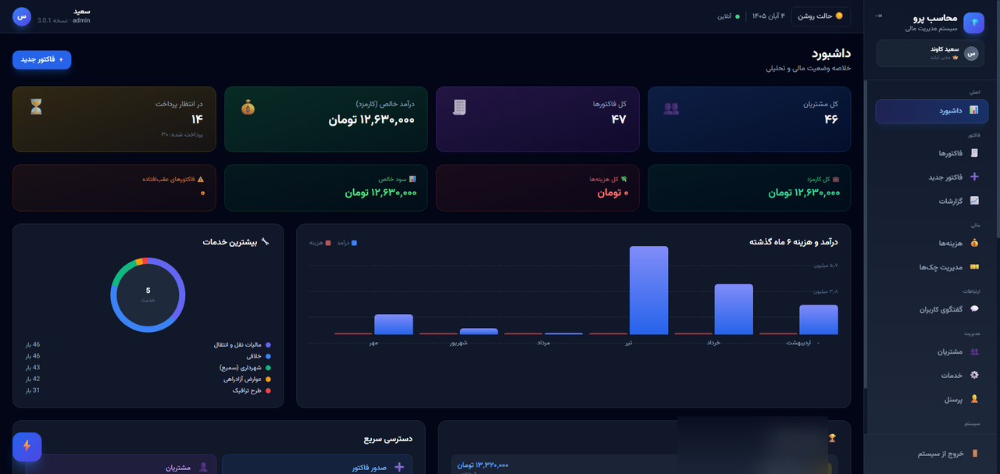

| فاکتور جدید | فاکتورها |
|---|---|
| 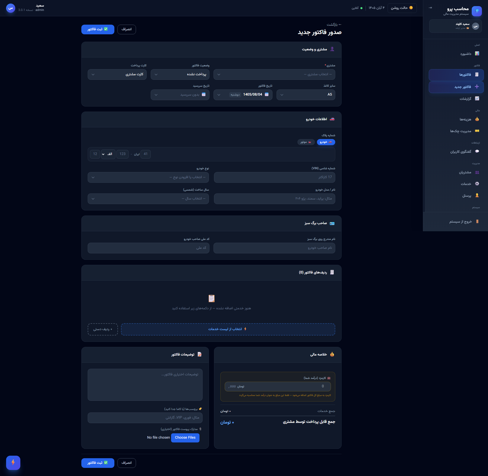 | 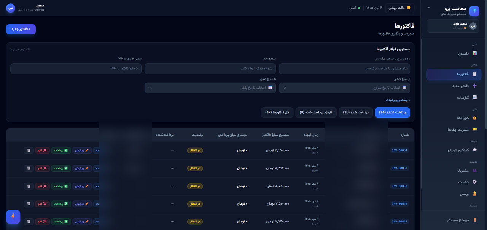 |

| جزئیات فاکتور | گزارش‌های مالی |
|---|---|
| 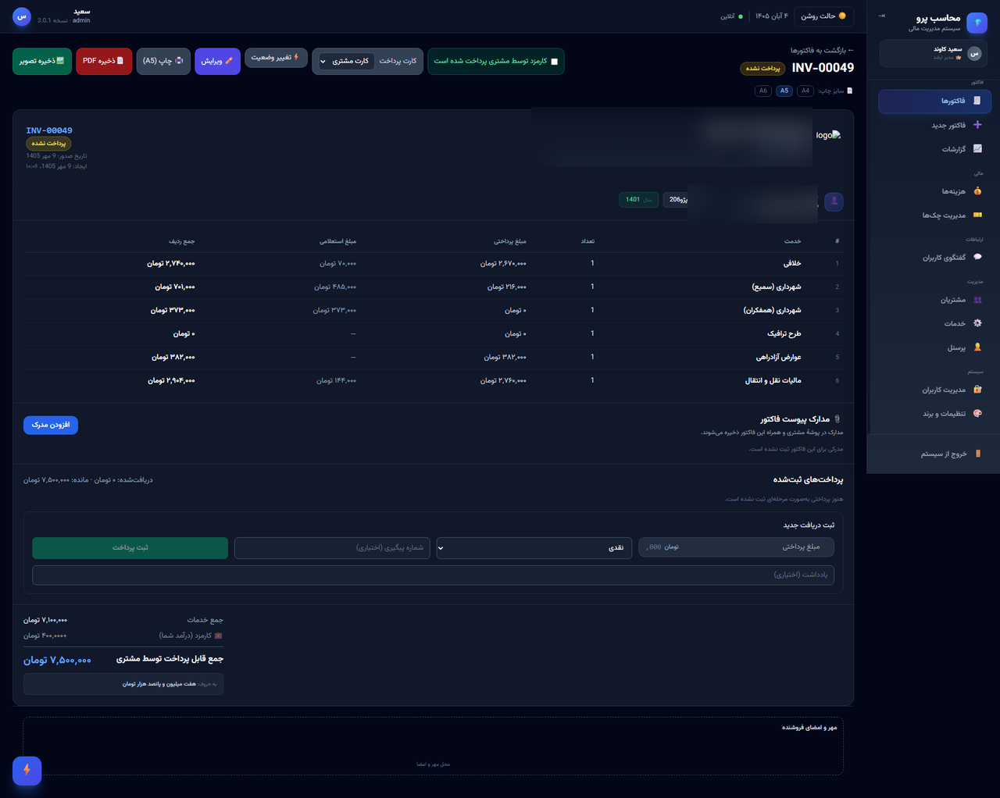 | 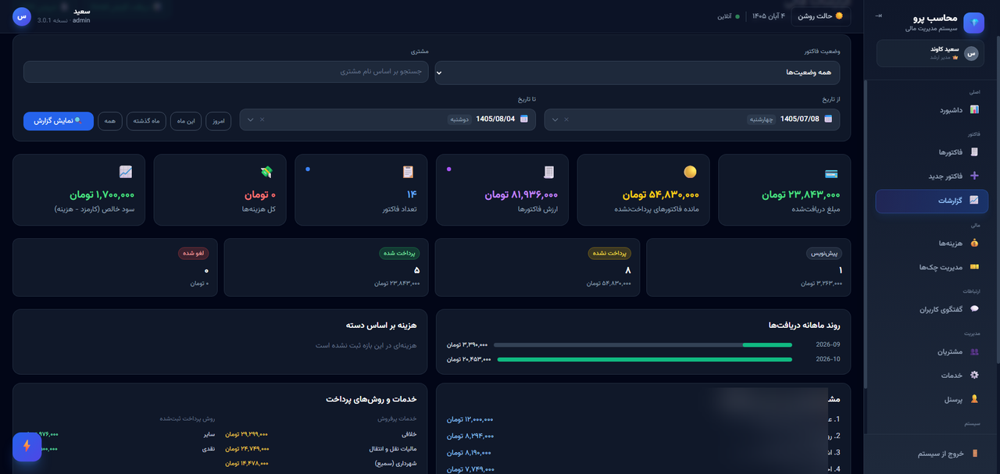 |

| مشتریان | خدمات |
|---|---|
| 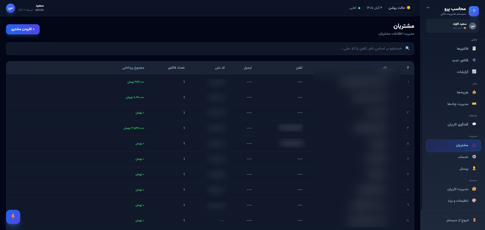 | 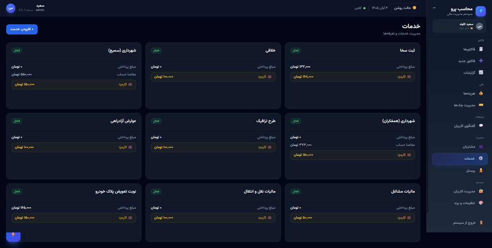 |

| هزینه‌ها | مدیریت چک‌ها |
|---|---|
| 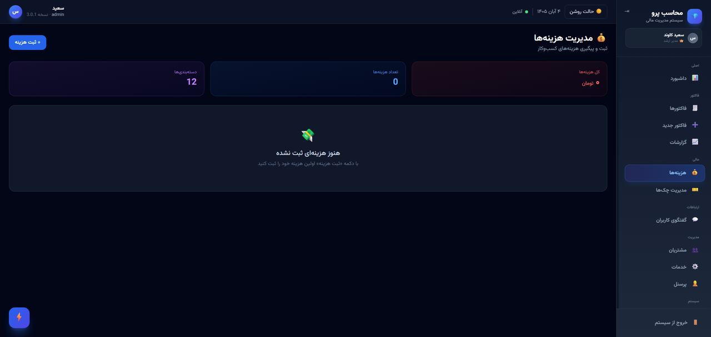 | 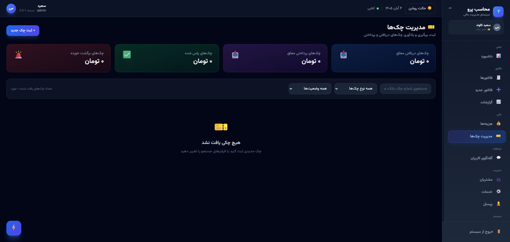 |

| تنظیمات | گفت‌وگوی کاربران |
|---|---|
| 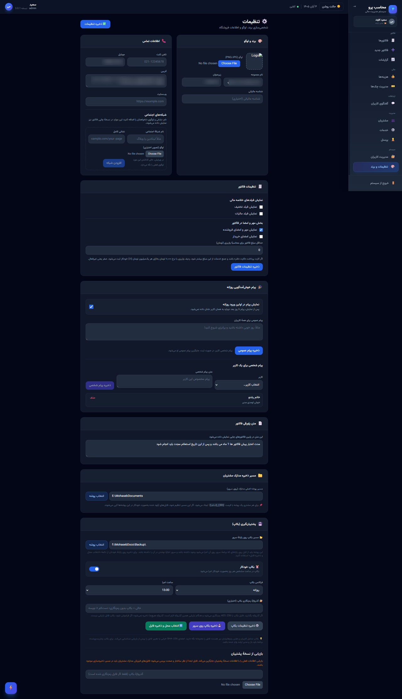 | 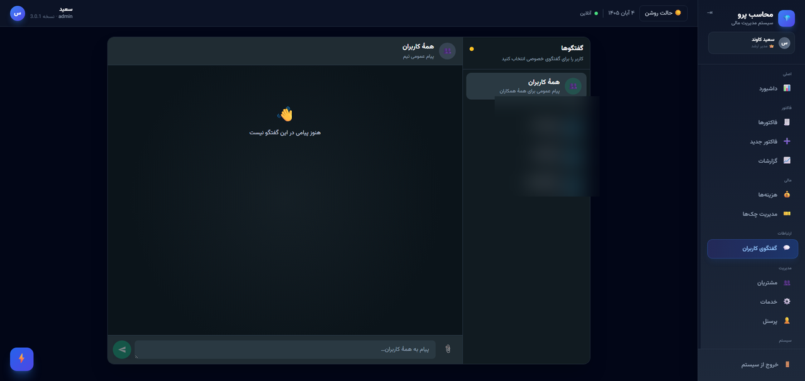 |

## امکانات

### صدور فاکتور
- **فاکتور سریع مرحله‌ای** — صدور در چهار مرحلهٔ کوتاه (مشتری و خودرو ← خدمات ← کارمزد ← وضعیت و ثبت)، کاملاً قابل انجام با صفحه‌کلید
- **پیشنهاد پلاک** — با واردکردن پلاک کامل، آخرین فاکتور همان خودرو پیشنهاد و با یک کلیک مشخصات و ردیف‌هایش بارگذاری می‌شود
- **پکیج‌های خدمات آماده** — تعریف پکیج در تنظیمات و افزودن همهٔ خدماتش با یک کلیک
- **صدور مشابه**، پیش‌نویس خودکار، و پیش‌فرض‌های به‌یادماندنی اپراتور (وضعیت و کارت پرداخت)
- فرم کامل فاکتور با بخش ساخت‌یافتهٔ خودرو/موتورسیکلت (پلاک، شاسی، نوع، مدل، سال)، برگ سبز و سررسید
- **چاپ دقیق یک‌صفحه‌ای** در اندازه‌های A4 و A5 و A6 و خروجی PDF/JPG از برگ فاکتور

### مدیریت و گزارش
- مشتریان، خدمات، هزینه‌ها، چک‌ها، کارکنان و کاربران با **سطوح دسترسی ماژولی**
- گزارش‌های مالی با خروجی Excel و CSV و سابقهٔ تغییرات (Audit)
- گفت‌وگوی زندهٔ کاربران با پیوست فایل و اعلان پیام جدید
- افزونهٔ صدور سریع فاکتور برای Chrome و Firefox

### پشتیبان‌گیری و امنیت
- پشتیبان‌گیری محلی زمان‌بندی‌شده + **پشتیبان ابری رمزنگاری‌شده** روی فضای S3 (مانند آروان‌کلاد) با بررسی checksum و حذف خودکار نسخه‌های قدیمی
- کلیدهای ابری به‌صورت رمزنگاری‌شده در پایگاه‌داده نگهداری می‌شوند، نه متن ساده
- احراز هویت JWT، محدودسازی نرخ تلاش‌های ورود و ثبت رویدادهای حساس

### تجربهٔ کاربری
- تم تیره و روشن با کنتراست بررسی‌شده (استاندارد WCAG AA)
- میانبرهای صفحه‌کلید قابل ویرایش از تنظیمات
- رابط کاملاً فارسی و راست‌چین با تاریخ شمسی و ارقام فارسی، قابل نصب به‌صورت PWA

## فناوری‌ها

| بخش | فناوری |
|---|---|
| Backend | Django 5 + Django REST Framework، Daphne (WebSocket)، SQLite |
| Frontend | React + TypeScript، Vite، TanStack Query، Tailwind CSS |
| چاپ و خروجی | CSS Print اختصاصی، خروجی Excel (openpyxl) |
| پشتیبان ابری | S3-Compatible (boto3) + رمزنگاری AES (Fernet) |

## پیش‌نیازها

- Windows 10 یا جدیدتر برای اسکریپت‌های آماده
- Python 3.10 یا جدیدتر (برای Python 3.15 در Windows، راه‌انداز پروژه به‌طور خودکار وابستگی شبکه را بدون افزونهٔ اختیاری C++ نصب می‌کند.)
- Node.js 18 یا جدیدتر و npm

## راه‌اندازی در Windows

1. مخزن را دریافت کنید:

   ```powershell
   git clone https://github.com/saeed-dev-nex/mohaseb-pro.git
   cd mohaseb-pro
   ```

2. فایل `run.bat` را اجرا کنید و حالت `dev` را انتخاب کنید. اسکریپت محیط مجازی Python و وابستگی‌های backend را آماده می‌کند؛ وابستگی‌های frontend را نیز در اولین اجرا با npm نصب کنید:

   ```powershell
   cd frontend
   npm install
   cd ..
   .\run.bat
   ```

3. برنامه را در نشانی `http://localhost:5173` باز کنید. API در `http://localhost:8000/api/` در دسترس است.

در نخستین راه‌اندازی backend، حساب مدیر ساخته می‌شود و گذرواژهٔ اولیه فقط همان‌بار در خروجی ترمینال نمایش داده می‌شود. آن را امن نگه دارید و پس از ورود تغییر دهید.

برای اجرای production روی یک پورت واحد، از `run_production.bat` و برای دسترسی سایر سیستم‌های شبکهٔ محلی، از `run_network.bat` استفاده کنید.

### نصب به‌صورت اپلیکیشن (PWA)

پس از اجرای نسخهٔ production با `npm run build` و `npm run preview`، برنامه را یک‌بار از `http://localhost:4173` در Chrome یا Edge باز کنید و دکمهٔ «نصب محاسب پرو» را انتخاب کنید (یا از آیکون نصب در نوار آدرس استفاده کنید). سپس برنامه از منوی Start یا میانبر دسکتاپ، بدون وارد کردن آدرس، اجرا می‌شود. نصب PWA به `localhost` یا HTTPS نیاز دارد؛ مرورگرها آن را روی نشانی HTTP شبکهٔ محلی نصب نمی‌کنند.

### به‌روزرسانی در هر سیستم

برای دریافت ایمن تغییرات GitHub، در پوشهٔ اصلی پروژه این دستور را اجرا کنید:

```powershell
.\update_project.ps1
```

اسکریپت ابتدا تغییرات ثبت‌نشده را بررسی می‌کند و اگر وجود داشته باشند هیچ فایلی را بازنویسی نمی‌کند. سپس تغییرات شاخهٔ فعلی را از `origin` ادغام می‌کند و migrationهای backend، وابستگی‌های frontend و build production را به‌روزرسانی می‌کند. برای دریافت کد بدون build، از `./update_project.ps1 -SkipBuild` استفاده کنید. این بررسی اکنون پیش از اجرای `run.bat` و `run_network.bat` نیز انجام می‌شود؛ اگر GitHub در دسترس نباشد یا تغییر محلی ثبت‌نشده‌ای داشته باشید، برنامه با نسخهٔ محلی اجرا می‌شود. به‌روزرسانی خودکار فقط برای پوشه‌ای کار می‌کند که با `git clone` دریافت شده باشد؛ نسخه‌های دانلودشده به‌صورت ZIP یا پوشهٔ انتشار، مخزن Git ندارند و با پیام اطلاع‌رسانی از نسخهٔ محلی اجرا می‌شوند.

## اجرا با Docker (همهٔ سیستم‌عامل‌ها)

اگر Docker دارید، بدون نصب Python و Node برنامه کامل بالا می‌آید:

```bash
cp .env.example .env   # سپس در .env یک DJANGO_SECRET_KEY تصادفی بگذارید
docker compose up --build
```

برنامه در `http://localhost:8080` باز می‌شود و API هم مستقیم در `http://localhost:8000/api/` در دسترس است. گذرواژهٔ اولیهٔ مدیر فقط در اولین اجرا در لاگ بک‌اند چاپ می‌شود: `docker compose logs backend`. دیتابیس و فایل‌های آپلودی در والیوم `mohaseb_data` می‌مانند و با خاموش/روشن‌کردن کانتینرها پاک نمی‌شوند.

### اجرای دستی

Backend:

```powershell
cd backend
py -3 -m venv .venv
.\.venv\Scripts\Activate.ps1
$env:AUTOBAHN_USE_NVX = "0" # برای Python 3.15 در Windows
python -m pip install -r requirements.txt
python manage.py migrate
python manage.py ensure_admin
python manage.py runserver
```

Frontend، در ترمینال جداگانه:

```powershell
cd frontend
npm install
npm run dev
```

## پیکربندی

تنظیمات Django را با متغیرهای محیطی انجام دهید؛ نمونهٔ همهٔ متغیرها در فایل [`.env.example`](.env.example) آمده است. برای محیط واقعی، `DJANGO_SECRET_KEY` را به یک مقدار تصادفی و خصوصی تغییر دهید، `DJANGO_DEBUG` را خاموش کنید و دامنه‌های مورداعتماد را صریحاً تعیین کنید. توجه: اگر `DJANGO_DEBUG` خاموش باشد و `DJANGO_SECRET_KEY` تنظیم نشده باشد، backend عمداً اجرا نمی‌شود؛ چون کلید تصادفیِ هر اجرا، همهٔ توکن‌های ورود را با هر ری‌استارت باطل می‌کند.

| متغیر | پیش‌فرض توسعه | توضیح |
| --- | --- | --- |
| `DJANGO_SECRET_KEY` | کلید تصادفی در هر اجرا | کلید خصوصی و پایدار Django را برای محیط واقعی تنظیم کنید. |
| `DJANGO_DEBUG` | `true` | برای محیط واقعی روی `false` بگذارید. |
| `DJANGO_ALLOWED_HOSTS` | `localhost,127.0.0.1,[::1]` | نام میزبان‌های مجاز، جداشده با ویرگول. |
| `DJANGO_CORS_ALLOWED_ORIGINS` | آدرس‌های loopback روی 5173 و 4173 | مبدأهای مجاز frontend، جداشده با ویرگول. |
| `VITE_API_URL` | نشانی backend بر اساس میزبان فعلی مرورگر | نشانی پایهٔ API برای frontend؛ `/api/` را نیز اضافه کنید. |

پایگاه‌دادهٔ SQLite و فایل‌های بارگذاری‌شده در پوشهٔ `backend/` نگهداری می‌شوند و بخشی از مخزن نیستند. از آن‌ها جداگانه پشتیبان بگیرید.

## افزونه‌های مرورگر

- **Chrome:** از صفحهٔ افزونه‌ها حالت Developer mode را فعال و `chrome-extension/` را بارگذاری کنید.
- **Firefox:** برای آزمایش موقت، `about:debugging` → `This Firefox` → `Load Temporary Add-on` را باز کنید و `firefox-extension/manifest.json` را انتخاب کنید؛ نصب موقت با بستن Firefox پاک می‌شود. برای نصب پایدار، بسته را با `firefox-extension/package.ps1` بسازید و پس از دریافت امضای AMO، فایل XPI را نصب کنید. راهنمای تصویری مرحله‌به‌مرحله در [`firefox-extension/INSTALL_FIREFOX_FA.md`](firefox-extension/INSTALL_FIREFOX_FA.md) است.

افزونه‌ها به backend محلی در `http://localhost:8000` متصل می‌شوند.

## ساختار مخزن

```text
backend/           Django REST API، مدل‌ها و مهاجرت‌های پایگاه‌داده
frontend/          برنامهٔ React و ابزارهای Vite
chrome-extension/  افزونهٔ Chrome
firefox-extension/ افزونهٔ Firefox
docs/images/       تصاویر مستندات از محیط واقعی برنامه
frontend/public/fonts/  قلم وزیرمتن (Self-hosted؛ بدون وابستگی به Google Fonts)
run.bat            راه‌انداز تعاملی Windows
run_network.bat    اجرای برنامه در شبکهٔ محلی
run_production.bat اجرای production تک‌پورت در Windows
```

## نسخه‌بندی

منبع واحد شمارهٔ نسخه فایل [`VERSION`](VERSION) است. از الگوی Semantic Versioning استفاده می‌کنیم: تغییر سازگارنشکن یا بازطراحی بزرگ، نسخهٔ اصلی را افزایش می‌دهد؛ قابلیت سازگار جدید، نسخهٔ فرعی را؛ و رفع اشکال سازگار، نسخهٔ اصلاحی را. سابقهٔ کامل انتشارها در [CHANGELOG](CHANGELOG.md) است.

## امنیت و داده‌های خصوصی

پایگاه‌داده، اسناد مشتریان، رسانه‌های بارگذاری‌شده، محیط‌های مجازی و خروجی‌های ساخت در `.gitignore` هستند. پیش از انتشار تغییرات، مطمئن شوید اطلاعات واقعی مشتری یا پشتیبان پایگاه‌داده به مخزن اضافه نشده باشد. حالت شبکهٔ محلی را فقط در شبکه‌ای اجرا کنید که به آن اعتماد دارید. جزئیات بیشتر در [SECURITY](SECURITY.md).

## مشارکت

برای تغییرات بزرگ، ابتدا یک Issue بسازید تا دربارهٔ راهکار هماهنگ شویم. تغییرات را در شاخه‌ای جداگانه انجام دهید و Pull Request را با شرح تغییر و مراحل بازبینی ارسال کنید. راهنمای کامل در [CONTRIBUTING](CONTRIBUTING.md).

## مجوز

این پروژه تحت [مجوز MIT](LICENSE) منتشر شده است.
