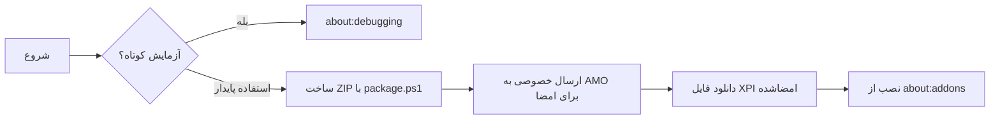
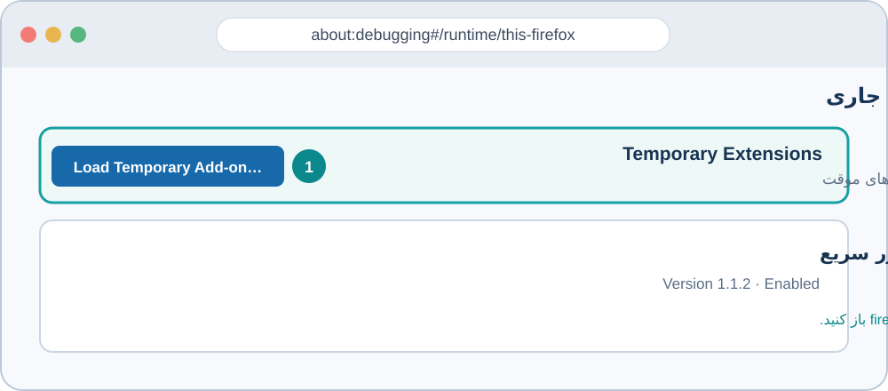
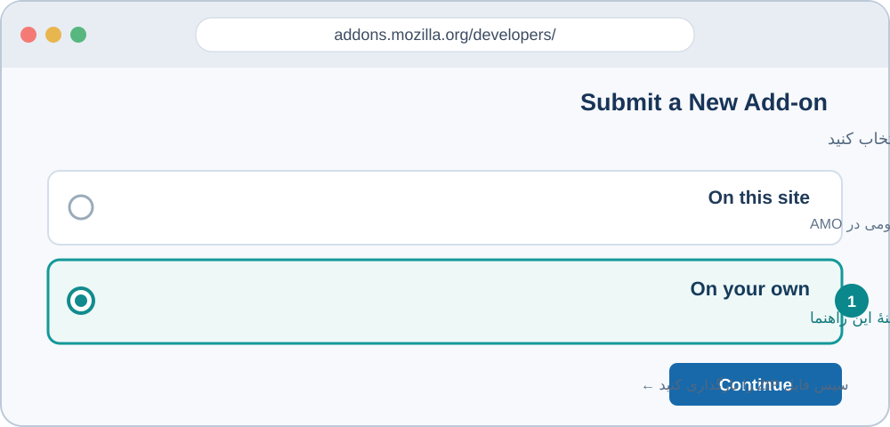
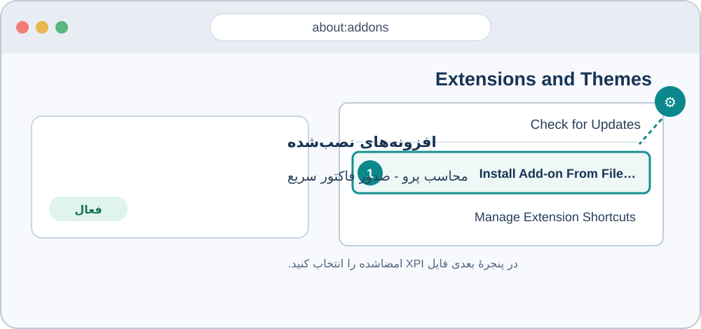

# راهنمای تصویری نصب افزونهٔ Firefox محاسب پرو

این راهنما هم نصب موقت برای آزمایش را توضیح می‌دهد و هم نصب پایدار را. تصویرها شماتیک‌اند و مسیر دکمه‌ها را نشان می‌دهند؛ ممکن است چیدمان Firefox شما کمی متفاوت باشد.

## اول روش مناسب را انتخاب کنید

| نیاز شما | روش |
|---|---|
| می‌خواهید افزونه را سریع آزمایش کنید | نصب موقت از `about:debugging`؛ با بستن Firefox پاک می‌شود |
| می‌خواهید افزونه پس از بستن و بازکردن Firefox باقی بماند | ساخت بسته، امضای Mozilla در AMO، سپس نصب فایل XPI امضاشده |

نسخهٔ جدید حداقل به **Firefox 140** نیاز دارد تا صفحهٔ رضایت داخلی Firefox برای داده‌هایی که افزونه استفاده می‌کند نمایش داده شود.



## پیش‌نیاز مهم: اجرای backend

افزونه به نشانی `http://localhost:8000/api/` متصل می‌شود. backend محاسب باید روی همان رایانه‌ای اجرا شود که Firefox روی آن باز است. برای اجرای محلی پروژه از `run.bat` استفاده کنید؛ `run_network.bat` نیز backend را روی همین رایانه اجرا می‌کند.

اگر Firefox روی رایانهٔ دیگری در شبکه است، تنظیم فعلی افزونه به سرور رایانهٔ میزبان وصل نمی‌شود؛ `localhost` همیشه به همان دستگاهی اشاره می‌کند که Firefox روی آن اجراست.

## روش اول: نصب موقت برای آزمایش

این روش نیازی به حساب Mozilla یا ساخت بسته ندارد. افزونه با خروج یا راه‌اندازی دوبارهٔ Firefox بارگذاری نمی‌ماند.

1. Firefox را باز کنید.
2. در نوار آدرس بنویسید `about:debugging` و Enter بزنید.
3. از ستون کناری، **This Firefox** را انتخاب کنید.
4. روی **Load Temporary Add-on…** بزنید.
5. در پوشهٔ پروژه فایل `firefox-extension/manifest.json` را انتخاب و **Open** کنید.
6. در بخش **Temporary Extensions** کارت «محاسب پرو - صدور فاکتور سریع» را ببینید؛ این نشانهٔ بارگذاری موفق است.



پس از بستن Firefox این افزونهٔ موقت حذف می‌شود. برای بارگذاری دوباره، مراحل بالا را تکرار کنید. این روش برای کاربران نهایی نیست؛ برای استفادهٔ ماندگار روش دوم را انجام دهید.

## روش دوم: نصب پایدار با امضای Mozilla

### بخش الف: ساخت بستهٔ AMO

1. PowerShell را باز کنید.
2. به پوشهٔ `firefox-extension` در پروژه بروید. برای نمونه:

   ```powershell
   cd D:\Mohaseb\firefox-extension
   ```

3. بسته را بسازید:

   ```powershell
   .\package.ps1
   ```

4. بسته در پوشهٔ `release` ساخته می‌شود. برای نسخهٔ فعلی نام آن `mohaseb-pro-firefox-1.1.2.zip` است. نام بسته از مقدار `version` در `manifest.json` گرفته می‌شود.

این ZIP برای بارگذاری در AMO است؛ Firefox آن را به‌عنوان افزونهٔ پایدار نصب نمی‌کند. باید ابتدا AMO آن را امضا کند و فایل `.xpi` امضاشده را بدهد.

### بخش ب: ارسال خصوصی به AMO برای امضا

1. وارد [AMO Developer Hub](https://addons.mozilla.org/developers/) شوید. با حساب Mozilla وارد شوید یا یک حساب بسازید.
2. **Submit a New Add-on** را انتخاب کنید.
3. برای محل توزیع، **On your own** را انتخاب کنید تا افزونه در فهرست عمومی AMO نمایش داده نشود.
4. در صفحهٔ بارگذاری، فایل ZIP ساخته‌شده در پوشهٔ `release` را انتخاب کنید.
5. صبر کنید اعتبارسنجی تمام شود. خطاهای مسدودکننده را رفع کنید؛ هشدارها را هم بخوانید.
6. مراحل بعدی را ادامه دهید. اگر AMO دربارهٔ ارسال کد منبع پرسید، مطابق پیام همان صفحه پیش بروید. فایل‌های JavaScript این پروژه خوانا و غیرمینیفای هستند.
7. پس از ثبت، صفحهٔ **Version Signature Pending** نمایش داده می‌شود. برای تمام‌شدن امضا منتظر ایمیل Mozilla بمانید.
8. از پیوند ایمیل یا **My Add-ons** به صفحهٔ افزونه بروید و **View All** را در بخش نسخه‌ها انتخاب کنید.
9. نسخه‌ای را که بارگذاری کردید باز کنید و پیوند فایل را با **Save Link As…** ذخیره کنید. این فایل XPI امضاشده است.



ممکن است AMO نسخه را برای بررسی بیشتر نگه دارد. تا وقتی فایل امضاشدهٔ XPI در صفحهٔ نسخه در دسترس نشده، ZIP بارگذاری‌شده را برای نصب نهایی به‌کار نبرید.

### بخش پ: نصب فایل XPI در Firefox

1. Firefox را باز کنید و در نوار آدرس `about:addons` را وارد کنید.
2. منوی چرخ‌دندهٔ صفحهٔ **Extensions and Themes** را باز کنید.
3. **Install Add-on From File…** را انتخاب کنید.
4. فایل `.xpi` امضاشده‌ای را که از AMO ذخیره کردید انتخاب کنید.
5. در پیام تأیید، **Add** را بزنید.
6. در فهرست افزونه‌ها بررسی کنید «محاسب پرو - صدور فاکتور سریع» نصب و فعال باشد.
7. Firefox را ببندید و دوباره باز کنید. افزونهٔ پایدار باید در فهرست باقی مانده باشد.

در نصب، Firefox دسته‌های دادهٔ موردنیاز را اعلام می‌کند: اطلاعات ورود حساب، اطلاعات هویتی مشتری (مثل نام و تلفن) و اطلاعات مالی فاکتور. این داده‌ها برای ساخت فاکتور به API محاسب روی همان رایانه فرستاده می‌شوند.



## بررسی عملکرد

1. backend محاسب را روی همان رایانه اجرا کنید.
2. آیکون افزونه را در نوار ابزار یا منوی افزونه‌های Firefox باز کنید.
3. پنجرهٔ افزونه باید باز شود. اگر فهرست‌ها یا اطلاعاتی بارگذاری نمی‌شوند، اتصال backend را بررسی کنید.

## رفع اشکال

| نشانه | علت محتمل و راه‌حل |
|---|---|
| افزونه پس از restart ناپدید شد | نصب موقت انجام شده است. مراحل امضای AMO را کامل و فایل XPI امضاشده را نصب کنید. |
| Firefox فایل را خراب یا نامعتبر می‌داند | احتمالاً ZIP ارسالی به AMO را انتخاب کرده‌اید. برای نصب باید XPI امضاشده را انتخاب کنید. |
| پنجره باز می‌شود اما داده‌ها نمی‌آیند | backend باید روی همین دستگاه در پورت `8000` در حال اجرا باشد. |
| Firefox در یک رایانه و backend در رایانه‌ای دیگر است | نسخهٔ فعلی افزونه به `localhost` وصل می‌شود و تنظیمی برای میزبان راه‌دور ندارد. |
| آیکون افزونه در نوار ابزار دیده نمی‌شود | منوی افزونه‌های Firefox را باز کنید و افزونه را به نوار ابزار سنجاق کنید. |

## به‌روزرسانی نسخهٔ نصب‌شده

1. مقدار `version` را در `manifest.json` افزایش دهید.
2. در `firefox-extension`، `package.ps1` را دوباره اجرا کنید.
3. نسخهٔ جدید را از صفحهٔ همان افزونه در **My Add-ons** بارگذاری کنید تا AMO آن را به‌عنوان به‌روزرسانی بشناسد.
4. پس از امضا، XPI تازه را دریافت و نصب کنید. اگر افزونه از AMO به‌صورت عمومی فهرست شده باشد، Firefox نسخه‌های منتشرشده را خودکار به‌روزرسانی می‌کند.

## منابع رسمی Mozilla

- [نصب موقت افزونه در Firefox](https://extensionworkshop.com/documentation/develop/temporary-installation-in-firefox/)
- [ارسال افزونه به AMO و انتخاب توزیع خصوصی](https://extensionworkshop.com/documentation/publish/submitting-an-add-on/)
- [نصب افزونهٔ امضاشده از فایل](https://extensionworkshop.com/documentation/publish/install-self-distributed/)
- [ساخت بستهٔ افزونه](https://extensionworkshop.com/documentation/publish/package-your-extension/)
